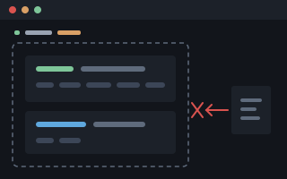
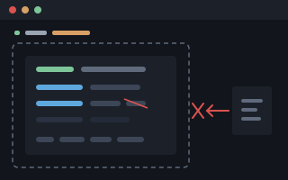
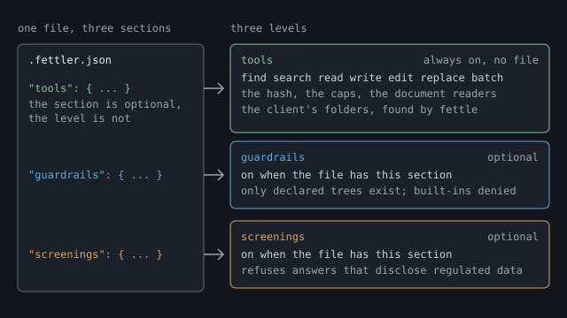

# Fettler &amp; Picker

**File and SQL Server tools built for an AI assistant, in place of the
1970s command-line tools it reaches for. Fewer calls, less context, and
nothing left half done. The files go through `fettle`. The SQL Server goes
through `pick`. Two programs, two front ends each, and no shell between
them and the data.**

| `fettle`: the files | `pick`: the SQL Server |
|---|---|
| <a href="https://shoddymills.github.io/shoddy-fettler/fettle-reference.html#boundary"></a> | <a href="https://shoddymills.github.io/shoddy-fettler/pick-reference.html#gate"></a> |
| **Find, search, read and edit files, with answers the next call takes as they are.** Start it in a folder and it works. Guardrails and screenings are optional levels on top. | **SELECT and DESCRIBE, one checked statement at a time.** No default database, no `USE`, no linked servers, no system catalog. The same two optional levels sit on top. |
| [Docs](https://shoddymills.github.io/shoddy-fettler/) &middot; [Quick start](https://shoddymills.github.io/shoddy-fettler/fettle-quickstart.html) | [Docs](https://shoddymills.github.io/shoddy-fettler/pick.html) &middot; [Quick start](https://shoddymills.github.io/shoddy-fettler/pick-quickstart.html) &middot; [Reference](https://shoddymills.github.io/shoddy-fettler/pick-reference.html) |

## Why is an AI assistant in 2026 using command-line tools like it's 1976?

Ask an assistant to rename a type across a project, then watch what it
runs. It reaches for `grep`, `sed` and `find`, or for its own copies of
them, one file at a time through a shell. Those tools are fifty years old,
and they were written for a person at a terminal. They answer in text
meant for eyes, they know nothing about the call that comes next, and each
one costs the assistant a round trip and a block of its context, the text
it can hold at one time.

Fettler gives the assistant the same jobs as verbs built for it. Each
answer is shaped to be the next call's argument, several things happen in
one call, and a change lands whole or not at all.

| The job | The built-in tool, or the shell | What went wrong | `fettle` |
|---|---|---|---|
| Find files | `Glob`, or `find` | Results swamped by `bin` and `node_modules`. A pattern that matches on one platform and not another. A list with no size or time, so a second call asks for them. | `find`: a pattern that means the same on every platform, with each file's size and time. Generated folders are skipped. It stops at 1,000 files and says so. |
| Search text | `Grep`, or `grep` | A pattern that runs away. A hit printed as text to be parsed again. A PDF or a spreadsheet skipped in silence, so the search reports nothing and looks complete. A brace pattern that matched nothing and said nothing. | `search`: several patterns in one call, each under a time limit. Each hit is `tree:path:line:column`. It looks inside PDF, Word and Excel files, and a pattern that matched no file says so. |
| Read a file | `Read`, or `cat` | A whole file into context for three lines of it. A minified file as one enormous line. An encoding guessed wrong and written back wrong. An answer so large the client rejects it, which costs a turn and returns nothing. | `read`: several paths in one call, a range or a tail, numbered lines, a hash of the content, and a size cap it states. The encoding is read from the file, never guessed. |
| Read a notebook | `NotebookEdit` | A megabyte of image data pasted into the conversation, for a picture nobody can see. | `read` returns the cells and measures an image output instead of pasting it. A notebook is JSON underneath, so `edit` changes it like any text file. |
| Create a file | `Write`, or `echo >` | A file overwritten without asking. A secret written into a checked-in file. A PowerShell here-string putting CRLF into an LF file. | `write`, `new`, `mkdir`: replacing a file needs saying so. Refused if the text would add a password or key, or if the file says what Fettler or the assistant may do. |
| Change a file | `Edit`, or `sed` | An anchor that no longer matches exactly, so the edit is retried until it lands, sometimes in the wrong place. Quotes, backslashes and newlines escaped onto a command line. `sed -i` rewriting every line ending for a one-line change. A byte-order mark spliced into the middle of a file. | `edit`: a batch of edits, anchored on text or on a line number, checked whole before a byte is written. Refused if the file changed since you read it, and a failed edit is named. Text can come from a file, so nothing is escaped. Line endings and encoding stay as they were. |
| Change many files | a `sed -i` loop | A loop that fails at file 15 and leaves 14 changed. No way to see the change before it is made. | `replace`: one substitution across a pattern of files, with a dry run first. All files change, or none do. |
| Move, copy, delete | `mv`, `cp`, `rm` | `rm -r` taking a folder nobody meant. A move that replaces its target without saying so. A path that climbs out of the project. | `move`, `copy`, `delete`: a path that leaves the tree is refused. Replacing a target needs saying so. A recursive delete that would reach a protected folder is refused whole. |
| Unpack an archive | `tar`, `unzip` | A member named `../../etc/passwd` landing outside the folder. A half-unpacked archive. A link member that escapes after every path check passed. | `extract`: every member is checked first, and the archive is refused whole if any would land outside. Links are refused. The execute bit is carried. |
| Several steps | a shell pipeline | Quoting that differs in every shell. A pipeline that fails halfway and leaves the state unknown. PowerShell 5.1 turning a native program's error output into an error of its own, with `$?` false on exit 0. | `batch`: one call, in order, stopping at the first step that fails and naming it. In JSON mode the whole answer is on standard output, failures included. |
| Run the build | `Bash`, `PowerShell`, `Monitor` | A command line composed from arguments, so a quote or a semicolon in a value changes what runs. A command that works on one machine and fails on the next. | `run`: a task the project declares, by name, with no arguments and a timeout. Nothing is composed. There is no shell. |
| Read back a long output | `BashOutput`, `TaskOutput` | Bytes that reach the model without passing the tree boundary, the credential check or the screen. | The client saves a long answer in its tool-results folder. `read` opens it there, read-only, through the same caps and checks as any other file. |

The second column is the eleven built-in tools that setup denies: six file
tools and two output readers at the tools level, and three shells once
guardrails are on. Each has a verb here that
answers in a form the next call can use. And there is no current
directory. Every path names its tree, so a call cannot land in the wrong
folder.

### One job, with the arithmetic

Renaming a C# type in this repository touches **200 places across 23
files**. Here it is done with the built-in tools, and done with Fettler.

| | Built-in file tools | Fettler |
|---|---|---|
| **Calls** | one search, then a read and an edit for each file: **47** | `search`, `replace --dry-run`, `replace`: **3** |
| **Context spent** | 23 whole files | the matching lines |
| **If it fails at file 15** | 14 files renamed and 9 not, and nothing says which half changed | nothing is written until all 23 files are checked |

**Scanning this repository's 15 MB of text takes a few hundred milliseconds.
So a call costs about a thousand times more than the work, and the number
of calls is what Fettler cuts.**

### What the tools do

| | |
|---|---|
| **Batching and pipelining** | `read` takes several paths. `search` takes several patterns. `batch` takes a whole sequence. Every answer is the next call's argument: `search` gives the place, `read` gives a hash, and `edit` takes the hash back. |
| **Paging and large answers** | Every answer stops at 40,000 bytes, and a read also stops at 2,000 lines. An answer that stops short says where to carry on from, even part way along one long line. A range reads the middle of a file, and `tail` reads the end of a log. A declared task keeps the end of its output and says how much it left out. A notebook's image output is measured, not pasted. One file cannot fill the assistant's context by accident. |
| **Documents, not only source** | Notebooks come back as cells. Excel comes back as rows, with the formulas, and with dates as dates. Word comes back as paragraphs under their headings, PDF as text per page, images as facts, and archive members without unpacking. A search looks inside all of them and cites the page. |
| **Reliability** | A batch is all or nothing. A file keeps its own encoding, line endings and execute bit. Results are ordered before any limit, so a cut answer is the same cut twice. A refusal says why in its first sentence. In JSON mode the whole answer is on standard output, failures included. |
| **Writes it refuses** | A write that would add a password or an access key to a file. A write to any file that says what Fettler or the assistant may do. |
| **The client's own folders** | This session's scratch folder, the tool-results and memory folders, and the working folder of a companion server such as sparky, all opened with nothing declared. |
| **One file, two front ends** | One self-contained file per operating system, with no .NET to install. A command line for scripts and an MCP server for assistants, and the two give the same answer byte for byte. |

### No WSL, no Git Bash, no Python

**On Windows, Fettler needs no WSL, no Git Bash, no Python and no .NET.**
It is one file that runs natively on Windows, macOS and Linux, and its
verbs are the same on each. The command an assistant runs from PowerShell
is the command it runs from bash. Nothing else is installed to make the
file tools work.

## Three levels

Both programs do three kinds of work, called **levels**. The tools are
always on. The other two turn on when the project's configuration file has
a section of that name, so a project that only wants the tools writes
nothing.

<p align="center">
  <a href="https://shoddymills.github.io/shoddy-fettler/#levels">
    
  </a>
</p>

| Level | On when | What it gives you |
|---|---|---|
| **tools** | always, with no file | everything above. For data: SELECT and DESCRIBE through the query gate |
| **guardrails** | the file has a `guardrails` section | the folders or databases you name, what may be done in each, and nothing else existing |
| **screenings** | the file has a `screenings` section | a screen that refuses any answer that would disclose regulated data |

### Guardrails: the folders you name

**With guardrails on, the world is a declared list.** A *tree* is a folder
you name, with a list of what may be done in it. Whatever you do not name
does not exist, and a path outside the trees is refused in the same words
as a file that was never there. The rules people arrive with are all
sayable:

| The rule you want | With guardrails on |
|---|---|
| **Look, don't touch.** | A tree can be read-only. It is the default for every tree but the one that holds the file. |
| **Work here, not there.** | Two trees. One grants writes, and the other keeps the read-only default. |
| **May add and revise, never destroy.** | Grant create, update and rename, and withhold delete. Most tooling cannot say this at all. |
| **Not for you.** | A folder granted nothing does not exist. It never appears in a search, and guessing its path answers the same as a path that was never there. |
| **Run the build, and nothing else.** | Declare the task by name and grant execute in one tree. There is no shell, so there is nothing else to run. |
| **All of that, but only under one folder.** | A scope: the same words, stated inside a tree. |

A setup command then turns off the assistant's built-in file tools and
shell, so Fettler is the only route to a file. Picker does the same for
databases, tables and columns, and a hidden column is missing from
`SELECT *` before the server sees the query.

### Screenings: refusing regulated data

**The screen refuses any answer that would disclose regulated data, and it
is off by default.** You name the tree or the database that holds the
records, and every answer leaving it is checked first. One match refuses
the whole answer, with exit code 13. It never hands back a redacted copy,
because a redacted copy looks safe and is not.

| Category | Catches | Needs |
|---|---|---|
| `identifiers` | social security numbers, valid card numbers, phone numbers, email addresses, labelled record numbers and labelled dates of birth | nothing installed. Six patterns run inside the program. |
| `clinical` | names, dates and conditions in clinical text | a model you install, run by `burler`, a second program |
| `legal` | contract and consumer-report text | a model |
| `scientific` | research and scientific data | a model |

Until a model is installed, the last three categories screen nothing, and
the tools say so in plain words. One set of models on disk serves both
programs.

**Nothing it does changes how _you_ work.** Your shell, your file explorer,
your editor and your git stay exactly as they were.

**[Read the docs](https://shoddymills.github.io/shoddy-fettler/)**
&nbsp;&middot;&nbsp;
[Quick start](https://shoddymills.github.io/shoddy-fettler/fettle-quickstart.html)
&nbsp;&middot;&nbsp;
[Installing it](https://shoddymills.github.io/shoddy-fettler/fettle-install.html)
&nbsp;&middot;&nbsp;
[Tools](https://shoddymills.github.io/shoddy-fettler/fettle-tools.html)
&nbsp;&middot;&nbsp;
[Guardrails](https://shoddymills.github.io/shoddy-fettler/fettle-guardrails.html)
&nbsp;&middot;&nbsp;
[Screenings](https://shoddymills.github.io/shoddy-fettler/fettle-screenings.html)

The project, the lane and the MCP server are **Fettler**. The thing a person
or a script types is **`fettle`**, the imperative, because
`fettle move a.txt b.txt` reads as an instruction and `fettler move` does
not. Both spellings are correct and neither is a typo.

The SQL twin follows the same arrangement. The project is **Picker** and the
command is **`pick`**. It is named for the rag pickers of the shoddy trade,
who picked and graded the stock by hand and altered none of it.

## Guardrails, drawn

With guardrails on, every path the assistant touches must sit inside a
*tree*, a folder you named ahead of time. Outside those trees everything is
refused: writing, reading, listing, even learning that a file exists. These
four drawings show one workstation with guardrails on. The pages they link
to explain every line.

<p align="center">
  <a href="https://shoddymills.github.io/shoddy-fettler/fettle-guardrails.html">
    
  </a>
  <br>
  <a href="https://shoddymills.github.io/shoddy-fettler/media/disk-map.svg">&#x26F6; Full screen</a>
</p>

**The disk, and every way off it.** The hatched ground is the whole machine,
and it is the default. The lit blocks are the entire list, not a summary of
it. The two exits open from one project only, because that is the single
place permitted to run anything. The Dropbox folder is sealed because it is
a way off the machine that no task opens and nothing here can close.

<p align="center">
  <a href="https://shoddymills.github.io/shoddy-fettler/fettle-guardrails.html">
    
  </a>
  <br>
  <a href="https://shoddymills.github.io/shoddy-fettler/media/workstation.svg">&#x26F6; Full screen</a>
</p>

**A workstation in fine fettle.** The client denies all eleven of its own
built-ins (the six file tools, the three shells, and the two output readers),
so the Fettler server is the only route to disk. Two of the eleven are
readers, `BashOutput` and `TaskOutput`. They start nothing, but they hand
back bytes that never passed the tree boundary or the screen.

**[Both diagrams full size, with the reasoning behind every line](https://shoddymills.github.io/shoddy-fettler/fettle-guardrails.html)**

<p align="center">
  <a href="https://shoddymills.github.io/shoddy-fettler/pick-guardrails.html">
    
  </a>
  <br>
  <a href="https://shoddymills.github.io/shoddy-fettler/media/pick-map.svg">&#x26F6; Full screen</a>
</p>

**The server, and the one way onto it.** The one lit database is the entire
list. The system databases, the neighbours, the catalog and the linked
servers are not on the map at all, and asking for any of them answers in
the same words as asking for a table that never existed. The one way in
carries one `SELECT` at a time, parsed whole, rewritten, and screened on the
way back.

<p align="center">
  <a href="https://shoddymills.github.io/shoddy-fettler/pick-guardrails.html">
    
  </a>
  <br>
  <a href="https://shoddymills.github.io/shoddy-fettler/media/pick-workstation.svg">&#x26F6; Full screen</a>
</p>

**A workstation, picked.** The model needs nothing new denied, because there
is no built-in SQL tool. pick takes its boundary from a file it re-reads
before every call and refuses to write. The server exists only as the
declared databases, behind a login that could not do more even if the gate
failed.

**[Both diagrams full size, with the reasoning behind every line](https://shoddymills.github.io/shoddy-fettler/pick-guardrails.html)**

## What is here

| Project | What it holds |
|---|---|
| `Fettler/Core` | the operations: containment, text, writes, glob, find, search, edit, file operations, tasks |
| `Fettler/Cli` | the command-line front end: verbs, exit codes, and both output modes |
| `Fettler/Mcp` | the MCP front end: stdio JSON-RPC, hand-rolled over `System.Text.Json` |
| `fettle` | the executable, and the whole of it is wiring |
| `burler` | the disclosure screen's model host, a **second** executable, for the reason below |
| `Picker` | the SQL boundary: verbs, grants, columns, the resolver, the ScriptDom query gate, both front ends |
| `pick` | a **third** executable. SELECT and DESCRIBE inside declared SQL Server databases, with its own MCP server |
| `Fettler.Tests` | the proof. Every item in R10 of the requirements is an assertion here |
| `burler.Tests` | burler's own proof, in its own project, so each side of the pipe asserts the wire independently |
| `Picker.Tests` | Picker's proof: the grant matrix and the whole query gate, pure against a catalog of literals |
| `docs/` | the published site, deployed to Pages from `main` |
| `scripts/` | the verifiers and the sitemap generator, all Node, all read-only bar one |
| `release-notes/` | one file per tag. The whole file becomes the release body |

## Building and working on it

**This repository is set up for Fettler, and builds itself with itself.**
The `guardrails` section of `.fettler.json` declares one tree and the tasks
below, so an assistant
working here reaches the build through `run` and never through a shell. That
is the tool's own argument applied to the tool. `run` executes only what the
configuration declares, never composes a command line, and needs the tree to
grant `execute`, which is never a default.

**None of that is required to build it.** Every task is a script in the root
of this repository, and a terminal is a first-class way in. The two routes
run the same file with the same arguments. There is no privileged path.

**This repository needs nothing built first.** Fettler references no project
outside its own tree, so there is no staged binary to publish and nothing to
weave. `scripts/fettler-build.ps1 test` is the whole suite and it runs in
minutes. There is no gate harness, no receipt store, and no `--resume`,
because there is nothing long enough to be worth resuming.

### From a terminal

```powershell
./scripts/fettler-build.ps1               # restore + build (Debug)
./scripts/fettler-build.ps1 test          # Fettler.Tests, burler.Tests AND Picker.Tests. All, always
./scripts/fettler-build.ps1 check         # the verifiers: twins, permissions, docs, errors
./scripts/fettler-build.ps1 release       # Release build
./scripts/fettler-build.ps1 publish 1.0.0 # self-contained single-file per OS, per program
./scripts/fettler-install.ps1             # install over the fettle on PATH
./scripts/fettler-install.ps1 1.0.0       # ...stamped as 1.0.0, and checked
./scripts/fettler-install.ps1 -Stop       # ...and end the servers still on the old build
```

`fettler-install.ps1` is the one that closes the loop on a change. It
publishes a self-contained `fettle` for this machine and puts it over
whichever one is already on `PATH`.

**A running copy does not stop it.** It never overwrites the file in place.
Windows moves the old one aside and copies into the name it vacates. Unix
renames the new one onto the old. So the write always succeeds and nothing
has to be killed to make room for it. What a running copy *does* mean is
that it goes on serving the old build until restarted, because a process
does not reload its own image. So `-Stop` is about effect, not about writing.
Without it you are told which pids are still on the old build. With it they
are ended, and only ever **after** the new file is in place and has answered
`--version`, so a failed build cannot leave you with nothing that works.

**It is not a declared task, deliberately.** Run through `fettle run` with
`-Stop` it would be a child of the very server it is ending, so the kill
would take the task with it before it could report. It refuses when it sees
that. It cannot restart an MCP server either, and does not pretend to. A
stdio server belongs to the client that launched it, so install, then
reconnect from the client.

The git workflow is scripted too, end to end apart from the merge:

```powershell
./scripts/fettler-branch.ps1 feature NAME              # cut a branch off an up-to-date main
./scripts/fettler-checkin.ps1 -Message "what changed"  # stage and commit; pushes nothing
./scripts/fettler-pr.ps1                               # push and open a pull request
                                               #   <- a person merges it on GitHub
./scripts/fettler-branch.ps1 land                      # return to main, delete the branch
./scripts/fettler-ship.ps1 1.0.0                       # tag and push. CI publishes
```

Every script has a `.sh` twin taking the same arguments, flags included. The
twins verifier fails the build if the two drift apart.
**On Windows run the `.ps1`.** It is the half that ships there, and the twin
that goes unexercised is the twin that rots.

[WORKFLOW.md](WORKFLOW.md) is that sequence in full.

### From an assistant, or any MCP client

The same commands, as declared tasks. From a terminal:

```powershell
fettle tasks              # what is declared, and what each would launch
fettle run test           # run one
```

From an MCP client the tools are `tasks` and `run`, taking the same names.
**A task takes no arguments from its caller.** Name and timeout are the only
inputs, and anything else is refused rather than ignored. A variant is a
second declared task, or a value the configuration declares in braces.

| Task | Runs | Mutates |
|---|---|---|
| `build` | `scripts/fettler-build.ps1 build` | build output |
| `test` | `scripts/fettler-build.ps1 test` | build output |
| `check` | `scripts/fettler-build.ps1 check` | stages an executable bit, if one is wrong |
| `build-release` | `scripts/fettler-build.ps1 release` | build output |
| `publish` | `scripts/fettler-build.ps1 publish {release-version}` | build output |
| `verify-twins` | `scripts/fettler-verify-twins.js` | nothing |
| `verify-permissions` | `scripts/fettler-verify-permissions.js` | stages an executable bit |
| `verify-docs` | `scripts/fettler-verify-docs.js` | nothing |
| `verify-errors` | `scripts/fettler-verify-errors.js` | nothing |
| `survey-readability` | `scripts/fettler-survey-readability.js` | nothing |
| `sitemap` | `scripts/fettler-make-sitemap.ps1` | `docs/sitemap.xml` |
| `feature` | `scripts/fettler-branch.ps1 feature {feature-branch}` | a local branch |
| `bug` | `scripts/fettler-branch.ps1 bug {bug-branch}` | a local branch |
| `sync` | `scripts/fettler-branch.ps1 sync` | your branch |
| `checkin` | `scripts/fettler-checkin.ps1 -Message {checkin-note}` | **history**, locally |
| `pr` | `scripts/fettler-pr.ps1` | **origin**, and opens a pull request |
| `pr-draft` | `scripts/fettler-pr.ps1 -Draft` | as above, as a draft |
| `land` | `scripts/fettler-branch.ps1 land -Yes` | **deletes** a merged branch |
| `ship` | `scripts/fettler-ship.ps1 {release-version} -Yes` | **publishes** a release |

**No task is named with a bare git word.** The committing task is `checkin`,
not `commit`, and every script carries the `fettler-` prefix, so an
assistant's permission layer never mistakes a declared task for the raw git
command it resembles.

The braced names are **replacements**: values the configuration supplies, so
a branch name or a version never has to be composed into a command line by
whoever is calling. They live in `.fettler.local.json`, which is gitignored,
so today's branch name stays out of the diff. An undeclared name is refused
and the configuration does not load. That is why the file is required here
rather than optional.

**The last five write something you cannot take back.** They are declared
because the whole procedure is meant to be reachable, not because they should
be run casually. `land` under `-Yes` refuses a branch it cannot confirm was
merged, and `ship` refuses on anything but a clean `main` whose CI is green.

## Where the rest of it is written down

This file is the shop window. **The documentation is the site**, and that is
the only place any of it is maintained. Nothing is repeated here, so nothing
here can drift out of step with it.

| You want | Page |
|---|---|
| Installed and working, in about five minutes | [Quick start](https://shoddymills.github.io/shoddy-fettler/fettle-quickstart.html) |
| The tools level: no file, the client's folders, companion servers | [Tools](https://shoddymills.github.io/shoddy-fettler/fettle-tools.html) |
| The guardrails level: trees, scopes, tasks, the deny list, drawn | [Guardrails](https://shoddymills.github.io/shoddy-fettler/fettle-guardrails.html) |
| The screenings level: refusing regulated data, and the models | [Screenings](https://shoddymills.github.io/shoddy-fettler/fettle-screenings.html) |
| Per-machine wiring, client registrations and the machine file | [Install](https://shoddymills.github.io/shoddy-fettler/fettle-install.html) |
| SELECT and DESCRIBE in SQL Server databases | [Pick](https://shoddymills.github.io/shoddy-fettler/pick.html) |
| A first SELECT, in about five minutes | [Pick: quick start](https://shoddymills.github.io/shoddy-fettler/pick-quickstart.html) |
| pick's tools level: a connection and the query gate | [Pick: tools](https://shoddymills.github.io/shoddy-fettler/pick-tools.html) |
| pick's guardrails level: databases, scopes and columns, drawn | [Pick: guardrails](https://shoddymills.github.io/shoddy-fettler/pick-guardrails.html) |
| pick's screenings level: refusing regulated rows, and the models | [Pick: screenings](https://shoddymills.github.io/shoddy-fettler/pick-screenings.html) |
| pick's per-machine wiring, and burler beside it | [Pick: install](https://shoddymills.github.io/shoddy-fettler/pick-install.html) |
| The query gate refusal by refusal, DESCRIBE's rules, pick's exit codes | [Pick: the reference](https://shoddymills.github.io/shoddy-fettler/pick-reference.html) |
| The boundary in full, every verb, every refusal, every exit code, the threat model | [Reference](https://shoddymills.github.io/shoddy-fettler/fettle-reference.html) |
| Why any of it is shaped the way it is | the source. The reasoning sits beside the code it explains |

## Contributing

[CONTRIBUTING.md](CONTRIBUTING.md) carries the invariants that must not be
quietly relaxed: no `ProjectReference` leaving this repository, a
`PackageReference` only from the allowlist, `Fettler.Core` naming no protocol
and no exit code, and the version living in the git tag rather than in a
file. [RELEASING.md](RELEASING.md) is the release path. [WORKFLOW.md](WORKFLOW.md)
is the sequence.

## Licence

MIT, &copy; 2026 Stephen Vincent Foster. `fettle` bundles PdfPig
(Apache-2.0). `pick` bundles Microsoft's ScriptDom parser and SqlClient
driver (both MIT). Every archive carries `NOTICE` and `LICENSE`, and
[THIRD-PARTY-NOTICES.md](THIRD-PARTY-NOTICES.md) is the full statement.
